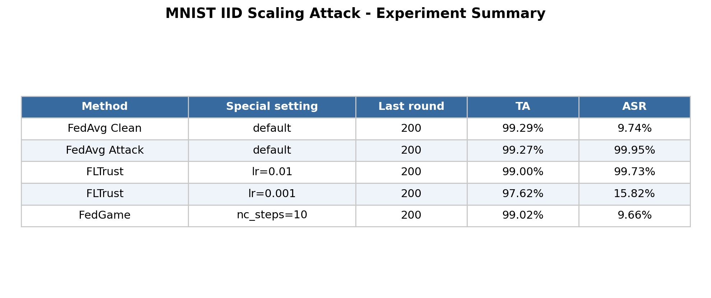
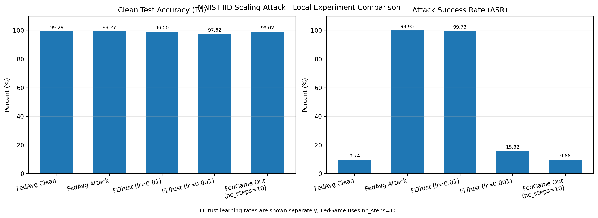
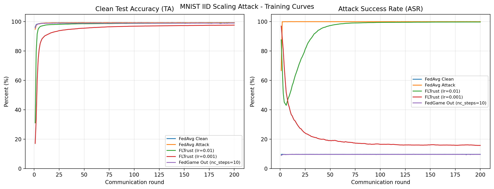

# FedGame：面向联邦学习动态后门攻击的博弈论防御复现报告

> 论文：**FedGame: A Game-Theoretic Defense against Backdoor Attacks in Federated Learning**（NeurIPS 2023）  
> 作者：Jinyuan Jia、Zhuowen Yuan、Dinuka Sahabandu、Luyao Niu、Arezoo Rajabi、Bhaskar Ramasubramanian、Bo Li、Radha Poovendran  
> 论文：[NeurIPS 2023 Paper](https://papers.nips.cc/paper_files/paper/2023/file/a6678e2be4ce7aef9d2192e03cd586b7-Paper-Conference.pdf)  
> 官方代码：[AI-secure/FedGame](https://github.com/AI-secure/FedGame)  
> 复现者：刘明鑫

## 1. 复现工作概述

本项目基于 FedGame 官方代码，对 MNIST、IID、Scaling Attack 条件下的联邦学习后门攻击与防御流程进行了缩小复现。

本次复现的主要目标不是严格重复论文表 1 的全部数值，而是验证以下基本结论：

1. Scaling Attack 在没有有效防御时能够成功植入后门；
2. FedGame 能够降低恶意客户端更新的聚合影响；
3. FedGame 能够在保持较高正常测试准确率的同时，将攻击成功率降低到接近随机预测水平；
4. 不同防御方法及训练参数可能对结果产生明显影响。

当前完成的工作包括：

- 建立适用于 WSL 的 Python 3.8 环境；
- 解决旧版 PyTorch 不支持 RTX 3050 Laptop GPU 的问题；
- 修复旧版 torchvision 下载 MNIST 时出现的 HTTP 404；
- 分别运行无攻击 FedAvg、受攻击 FedAvg、FLTrust 和 FedGame；
- 对 FLTrust 的 `lr=0.01` 和 `lr=0.001` 分别进行测试；
- 将 FedGame 的触发器反向工程步数设为 `nc_steps=10`，完成200轮趋势验证；
- 从 TensorBoard 事件文件中提取 TA 和 ASR；
- 生成训练曲线、实验对比图、结果表格图片及 CSV 文件。

当前实验属于**单数据集、单攻击类型、单随机种子的趋势验证**，不能视为论文全部实验的严格复现。

## 2. 实验环境与主要设置

### 2.1 运行环境

| 项目 | 当前设置 |
| --- | --- |
| 操作系统 | Windows 11 + WSL |
| Python | 3.8 |
| GPU | NVIDIA GeForce RTX 3050 Laptop GPU |
| PyTorch | 1.8.0+cu111 |
| torchvision | 0.9.0+cu111 |
| 数据集 | MNIST |
| 服务器辅助数据 | FashionMNIST |
| 模型 | 官方代码中的 MNIST SimpleNet |
| 攻击 | Scaling Attack |
| 防御 | FedAvg、FLTrust、FedGame |
| 通信轮数 | 200 |
| 随机种子 | 0 |

### 2.2 联邦学习设置

| 参数 | 数值 | 含义 |
| --- | ---: | --- |
| `fl_total_participants` | 10 | 总客户端数量 |
| `fl_no_models` | 10 | 每轮参与聚合的客户端数量 |
| `fl_number_of_adversaries` | 6 | 恶意客户端数量 |
| `fl_local_epochs` | 2 | 每轮本地训练次数 |
| `fl_eta` | 1 | 服务器更新系数 |
| `fl_weight_scale` | 1.6667 | Scaling Attack 的更新放大系数 |
| `fl_q` | 0.1 | MNIST 标签分配接近 IID |
| `clean_ratio` | 0.1 | 服务器辅助数据比例 |
| `backdoor_label` | 8 | 后门目标类别 |
| `attack_start_epoch` | 1 | 从第1轮开始攻击 |
| `epochs` | 200 | 总通信轮数 |

在当前代码的标签分配方式中，MNIST 有10个类别：

- `fl_q=0.1` 时，各客户端上的标签比例接近一致，可视为 IID；
- `fl_q` 增大时，客户端数据逐渐集中于对应标签；
- `fl_q` 越接近1，标签偏斜越严重。

### 2.3 FedGame 特殊设置

| 参数 | 数值 | 说明 |
| --- | ---: | --- |
| `clean_set_dataset` | FashionMNIST | 使用域外服务器辅助数据 |
| `clean_ratio` | 0.1 | 辅助数据比例为10% |
| `ours_lbd` | 1 | FedGame 权衡参数 |
| `attacker_train_ratio` | 0.9 | 攻击者训练数据比例 |
| `r_interval` | 0.1 | 投毒比例搜索间隔 |
| `nc_steps` | 10 | 候选触发器反向工程步数 |
| `static` | False | 使用动态攻击者设置 |

论文默认通常使用 `nc_steps=100`。本次为了降低运行时间，将其改为10。

因此，本次 FedGame 实验用于验证防御趋势，不要求与论文表格数值完全一致。

## 3. 方法简述

### 3.1 联邦学习后门攻击

在联邦学习中，服务器将全局模型发送给多个客户端。客户端使用本地数据训练模型，并将模型更新发送回服务器进行聚合。

恶意客户端可以在本地训练数据中加入带有触发器的样本，并将其标签修改为攻击目标类别。

攻击成功后：

- 正常样本仍能被模型正确分类；
- 含有特定触发器的样本会被预测为攻击者指定的目标类别。

因此，需要同时观察两个指标：

- **TA（Test Accuracy）**：正常测试样本的准确率，越高越好；
- **ASR（Attack Success Rate）**：带触发器样本被预测为攻击目标的比例，越低越好。

理想防御应当同时保持较高 TA 和较低 ASR。

### 3.2 Scaling Attack

Scaling Attack 会放大恶意客户端的模型更新，使多个恶意更新在服务器聚合时产生更大的影响。

本次实验设置：

```yaml
fl_number_of_adversaries: 6
fl_weight_scale: 1.6667
poisoning_proportion: 1
backdoor_label: 8
```

其目标是在尽量保持正常任务准确率的同时，将后门植入全局模型。

### 3.3 FedAvg

FedAvg 直接对参与客户端的更新进行平均，没有专门的恶意客户端检测和后门防御机制。

因此，本项目分别运行：

- 无攻击 FedAvg：获得正常训练基线；
- Scaling Attack + FedAvg：验证攻击能否成功。

### 3.4 FLTrust

FLTrust 使用服务器可信数据生成参考更新，并根据客户端更新与参考更新之间的**方向一致性**分配聚合权重。

本次实验发现 FLTrust 对学习率较为敏感，因此分别保留：

- `lr=0.01`；
- `lr=0.001`。

两组结果均展示在最终图表中，但必须明确标注学习率，不能将不同参数下的结果视为完全相同的实验条件。

### 3.5 FedGame

FedGame 将服务器与动态攻击者的交互建模为极小极大博弈。

服务器端每轮主要执行以下步骤：

1. 将本轮客户端更新进行简单平均，构造参考辅助模型；
2. 针对所有候选类别分别反向工程触发器；
3. 比较各类别候选触发器的掩码范数；
4. 将掩码范数最小的类别视为候选攻击目标；
5. 将对应候选触发器加入服务器干净数据；
6. 在每个客户端模型上测试候选触发器；
7. 根据模型没有被候选触发器诱导为目标类别的比例，计算真实性分数；
8. 按真实性分数对客户端更新进行加权聚合。

因此，FedGame 不需要预先知道真实攻击目标类别，而是通过逐类别反向工程确定候选目标。

恶意客户端为了让后门生效，通常需要使本地模型对触发器产生明显响应。这种响应又可能导致其真实性分数降低，从而削弱恶意更新在全局聚合中的权重。

## 4. 环境准备

### 4.1 创建 Python 环境

建议在 WSL 中使用独立环境：

```bash
conda create -n fedgame python=3.8 -y
conda activate fedgame
```

也可以使用 Python 虚拟环境：

```bash
python3 -m venv ~/.venvs/fedgame
source ~/.venvs/fedgame/bin/activate
```

升级基础安装工具：

```bash
python -m pip install --upgrade pip setuptools wheel
```

### 4.2 安装项目依赖

原始 `requirements.txt` 中使用了已经废弃的 `sklearn` 安装包名称。可以临时允许安装：

```bash
export SKLEARN_ALLOW_DEPRECATED_SKLEARN_PACKAGE_INSTALL=True
python -m pip install -r requirements.txt
```

更规范的处理方式是将 `requirements.txt` 中的：

```text
sklearn~=0.0
```

改为：

```text
scikit-learn~=0.23.2
```

### 4.3 安装支持 RTX 3050 的 PyTorch

官方依赖中的 PyTorch 1.7.x 不支持 RTX 3050 Laptop GPU 的 `sm_86` CUDA 架构，会出现：

```text
CUDA error: no kernel image is available for execution on the device
```

本次改用：

```bash
python -m pip install --force-reinstall \
  torch==1.8.0+cu111 \
  torchvision==0.9.0+cu111 \
  -f https://download.pytorch.org/whl/torch_stable.html
```

安装后检查：

```bash
python -c "import torch; print('PyTorch:', torch.__version__); print('CUDA:', torch.version.cuda); print('GPU可用:', torch.cuda.is_available()); print('显卡:', torch.cuda.get_device_name(0)); print(torch.ones(1, device='cuda'))"
```

正常情况下应显示：

- PyTorch 1.8.0+cu111；
- CUDA 可用；
- NVIDIA GeForce RTX 3050 Laptop GPU；
- CUDA 张量创建成功。

### 4.4 创建输出目录

```bash
mkdir -p runs
mkdir -p saved_models
mkdir -p plots
```

## 5. 数据准备

MNIST 和 FashionMNIST 会在首次运行时自动下载到：

```text
.data/
```

旧版 torchvision 中的 MNIST 默认下载地址已经失效，可能出现：

```text
HTTP Error 404: Not Found
```

本项目在 `tasks/mnist_task.py` 中将数据地址替换为：

```text
https://ossci-datasets.s3.amazonaws.com/mnist/
https://fashion-mnist.s3.eu-central-1.amazonaws.com/
```

因此，首次运行时程序会自动从可用地址下载并解压数据。

## 6. 配置文件

本项目新增了以下复现配置：

| 配置文件 | 实验 |
| --- | --- |
| `configs/repro_mnist_clean_iid.yaml` | IID、无攻击 FedAvg |
| `configs/repro_mnist_scaling_fedavg_iid.yaml` | IID、Scaling Attack + FedAvg |
| `configs/repro_mnist_scaling_fltrust_iid.yaml` | IID、Scaling Attack + FLTrust，`lr=0.01` |
| `configs/repro_mnist_scaling_fltrust_iid_lr001.yaml` | IID、Scaling Attack + FLTrust，`lr=0.001` |
| `configs/repro_mnist_scaling_fedgame_out_iid.yaml` | IID、Scaling Attack + FedGame、域外辅助数据、`nc_steps=10` |
| `configs/debug_mnist_fedgame_out_iid.yaml` | FedGame 两轮调试实验 |

配置文件名称中的：

- `clean` 表示没有恶意客户端；
- `scaling` 表示 Scaling Attack；
- `iid` 表示 `fl_q=0.1`；
- `out` 表示服务器使用域外 FashionMNIST 数据；
- `lr001` 表示学习率为0.001；
- `nc10` 表示 FedGame 使用 `nc_steps=10`。

## 7. 运行实验

所有命令均从项目根目录执行。

### 7.1 可选：运行两轮调试实验

调试配置仅用于检查代码、数据下载、GPU和日志是否正常：

```bash
python training.py \
  --name debug_mnist_fedgame_out_iid \
  --params configs/debug_mnist_fedgame_out_iid.yaml
```

该配置只运行两轮，不能作为正式实验结果。

### 7.2 无攻击 FedAvg

```bash
python training.py \
  --name repro_mnist_clean_iid \
  --params configs/repro_mnist_clean_iid.yaml
```

### 7.3 Scaling Attack + FedAvg

```bash
python training.py \
  --name repro_mnist_scaling_fedavg_iid \
  --params configs/repro_mnist_scaling_fedavg_iid.yaml
```

### 7.4 Scaling Attack + FLTrust，lr=0.01

```bash
python training.py \
  --name repro_mnist_scaling_fltrust_iid \
  --params configs/repro_mnist_scaling_fltrust_iid.yaml
```

### 7.5 Scaling Attack + FLTrust，lr=0.001

```bash
python training.py \
  --name repro_mnist_scaling_fltrust_iid_lr001 \
  --params configs/repro_mnist_scaling_fltrust_iid_lr001.yaml
```

### 7.6 Scaling Attack + FedGame

```bash
python training.py \
  --name repro_mnist_scaling_fedgame_out_iid_nc10 \
  --params configs/repro_mnist_scaling_fedgame_out_iid.yaml
```

FedGame 每轮需要反向工程候选触发器，运行速度明显慢于 FedAvg 和 FLTrust。

本次使用 `nc_steps=10`，目的是在个人计算设备上完成200轮趋势验证。该设置不能视为论文默认 `nc_steps=100` 的严格复现。

## 8. TensorBoard 与结果提取

### 8.1 启动 TensorBoard

```bash
tensorboard --logdir runs --host 0.0.0.0 --port 6006
```

在浏览器中打开：

```text
http://localhost:6006
```

主要关注：

```text
Test_backdoor_False/Accuracy_Top-1
Test_backdoor_True/Accuracy_Top-1
Server/Genuine_Scores
Client/r
```

其中：

- `Test_backdoor_False/Accuracy_Top-1` 对应 TA；
- `Test_backdoor_True/Accuracy_Top-1` 对应 ASR；
- `Server/Genuine_Scores` 记录服务器计算的客户端真实性分数；
- `Client/r` 记录恶意客户端选择的投毒比例。

### 8.2 查看单个 TensorBoard 目录

项目提供了 `inspect_tensorboard.py`：

```bash
python inspect_tensorboard.py runs/repro_mnist_scaling_fedgame_out_iid_nc10
```

该脚本会输出：

- 可用 TensorBoard 标签；
- 每个指标的数据数量；
- 首轮和末轮数值；
- 最小值和最大值；
- 前若干轮及最后若干轮结果。

### 8.3 生成图表

全部实验完成后执行：

```bash
python plot_results.py
```

程序会读取 `runs/` 中的 TensorBoard 事件文件，并在 `plots/` 中生成：

```text
plots/training_curves.png
plots/experiment_comparison.png
plots/results_summary_table.png
plots/results_summary.csv
```

其中：

- `training_curves.png`：TA 和 ASR 随通信轮次变化的曲线；
- `experiment_comparison.png`：不同方法最终 TA 和 ASR 的柱状图；
- `results_summary_table.png`：图片形式的实验结果表；
- `results_summary.csv`：便于后续统计处理的原始结果表。

## 9. 本地实验结果

### 9.1 结果汇总表



| 方法 | 特殊设置 | 最终轮数 | TA | ASR |
| --- | --- | ---: | ---: | ---: |
| FedAvg Clean | 无攻击 | 200 | 99.29% | 9.74% |
| FedAvg Attack | Scaling Attack | 200 | 99.27% | 99.95% |
| FLTrust | `lr=0.01` | 200 | 99.00% | 99.73% |
| FLTrust | `lr=0.001` | 200 | 97.62% | 15.82% |
| FedGame | 域外辅助数据，`nc_steps=10` | 200 | 99.02% | 9.66% |

无攻击 FedAvg 的 `ASR=9.74%` 并不表示存在后门攻击。由于 MNIST 有10个类别，该数值接近随机预测到目标类别的比例，可以作为后门测试的基线。

### 9.2 最终结果对比



本次结果显示：

1. **FedAvg 无攻击时能够正常收敛。**  
   最终 TA 为99.29%，说明基础训练流程正常。

2. **Scaling Attack 在没有防御时成功。**  
   FedAvg Attack 的 TA 为99.27%，但 ASR 达到99.95%。这说明攻击者几乎没有破坏正常准确率，却成功植入了后门。

3. **FLTrust 对当前训练参数较为敏感。**  
   `lr=0.01` 时，FLTrust 的 ASR 为99.73%，没有成功阻止攻击。  
   将学习率降低到0.001后，ASR下降到15.82%，但 TA 同时下降到97.62%。

4. **FedGame 在当前设置下表现出较好的防御趋势。**  
   使用域外 FashionMNIST 辅助数据和 `nc_steps=10` 时，FedGame 的 TA 为99.02%，ASR 为9.66%。

5. **FedGame 的 ASR 接近无攻击基线。**  
   这说明在本次 MNIST IID Scaling Attack 实验中，FedGame 基本消除了后门带来的额外目标类别倾向。

### 9.3 训练曲线



训练曲线用于观察：

- 各方法是否正常收敛；
- 后门攻击从何时开始生效；
- 防御效果是否只在最后一轮出现；
- TA 和 ASR 在训练过程中是否稳定；
- 是否存在中途异常、震荡或短暂后门泄漏。

与只展示最终结果相比，训练曲线能够更完整地反映防御过程。

### 9.4 本次实验能够支持的结论

本次实验支持以下结论：

> 在当前 MNIST、IID、Scaling Attack、10个客户端和单随机种子条件下，FedGame 即使只使用10步触发器反向工程，也能够将 ASR 从接近100%降低到接近随机预测水平，同时保持约99%的正常测试准确率。

但本次实验不能证明：

- FedGame 在所有数据集上都优于其他方法；
- FedGame 在所有 non-IID 条件下都有效；
- `nc_steps=10` 与论文默认 `nc_steps=100` 完全等价；
- FLTrust 一定无效；
- 当前单次运行具有统计显著性；
- 当前结果可以直接代表论文表1的全部结果。

## 10. 遇到的困难及解决办法

### 10.1 `torch` 模块没有安装

**问题：**

最初直接运行：

```bash
python -c "import torch"
```

出现：

```text
ModuleNotFoundError: No module named 'torch'
```

**原因：**

当前终端使用的 Python 环境中没有安装项目依赖。

**解决办法：**

创建并激活独立的 `fedgame` 环境，然后安装 `requirements.txt`。

### 10.2 `sklearn` 安装失败

**问题：**

安装依赖时出现：

```text
The 'sklearn' PyPI package is deprecated, use 'scikit-learn'
```

**原因：**

项目依赖文件仍使用已经废弃的 `sklearn` 占位包。

**解决办法：**

临时设置：

```bash
export SKLEARN_ALLOW_DEPRECATED_SKLEARN_PACKAGE_INSTALL=True
```

或者直接将依赖文件中的 `sklearn` 改成 `scikit-learn`。

### 10.3 MNIST 下载地址返回404

**问题：**

旧版 torchvision 尝试从以下地址下载 MNIST：

```text
http://yann.lecun.com/exdb/mnist/
```

该地址返回 HTTP 404。

**解决办法：**

在 `tasks/mnist_task.py` 中替换 MNIST 和 FashionMNIST 的下载地址，同时保留原始文件名和校验信息。

### 10.4 PyTorch 不支持 RTX 3050

**问题：**

PyTorch 1.7.x 只能支持较旧的 CUDA 架构，运行时出现：

```text
NVIDIA GeForce RTX 3050 Laptop GPU with CUDA capability sm_86
is not compatible with the current PyTorch installation
```

随后报错：

```text
CUDA error: no kernel image is available for execution on the device
```

**解决办法：**

将 PyTorch 和 torchvision 升级为：

```text
torch 1.8.0+cu111
torchvision 0.9.0+cu111
```

升级后 CUDA 张量能够在 RTX 3050 Laptop GPU 上正常运行。

### 10.5 FedGame 运行时间较长

**问题：**

FedGame 每轮都要针对多个类别执行候选触发器反向工程。使用默认 `nc_steps=100` 时，个人设备完成200轮训练耗时较长。

**解决办法：**

将复现配置中的：

```yaml
nc_steps: 100
```

调整为：

```yaml
nc_steps: 10
```

这样能够完成趋势验证，但必须在结果中明确标注，不能将其视为论文默认设置。

### 10.6 `log.txt` 内容不完整

**问题：**

部分 `saved_models/.../log.txt` 中只有最开始的日志路径，没有保存终端中显示的全部训练信息。

**影响：**

这不影响 TensorBoard 图表，因为 TA、ASR 和真实性分数保存在 `runs/` 下的事件文件中。

**解决办法：**

实验指标统一从 TensorBoard 事件文件读取，并使用：

```bash
python inspect_tensorboard.py <运行目录>
python plot_results.py
```

进行提取和绘图。

### 10.7 FLTrust 两组结果差别较大

**问题：**

FLTrust 在 `lr=0.01` 和 `lr=0.001` 时出现明显不同的 ASR。

**处理方式：**

保留两组结果，并在表格和图片中分别标注学习率。

不能只选择表现更好的结果而隐藏另一组，也不能把不同学习率的结果解释为完全公平的同参数比较。

## 11. 可复现性与限制说明

1. 当前只复现 MNIST，没有运行 CIFAR-10 和 Tiny ImageNet。
2. 当前只测试 Scaling Attack，没有复现 DBA 和 Neurotoxin。
3. 当前主要测试 IID，即 `fl_q=0.1`。
4. 当前没有系统测试不同程度的 non-IID。
5. 当前只有单随机种子，没有计算平均值和标准差。
6. FedGame 使用 `nc_steps=10`，不是论文默认的100。
7. FedGame 使用 FashionMNIST 作为域外服务器辅助数据。
8. FLTrust 的两组结果使用了不同学习率，不能视为完全相同参数下的比较。
9. 当前实验规模为10个客户端，其中6个为恶意客户端。
10. 当前结果适合说明代码流程已经跑通以及防御趋势存在，不能宣称完整复现了论文全部实验。
11. 本项目不以逐项匹配论文表格数值为目标，而是验证攻击和防御的基本结论。
12. 由于只完成单次运行，当前结果不能代替多随机种子的统计实验。

## 12. 方法解决的问题、局限与研究启发

### 12.1 方法解决的问题

传统联邦学习后门防御通常基于固定攻击策略设计。

但现实中的攻击者可能根据防御效果动态调整：

- 每轮投毒数据比例；
- 攻击强度；
- 触发器；
- 后门成功率与隐蔽性之间的权衡。

FedGame 将服务器和动态攻击者建模为极小极大博弈，并通过反向工程候选触发器、计算客户端真实性分数和加权聚合，降低表现出后门行为的客户端更新权重。

其主要贡献可以概括为：

> FedGame 不只是根据模型参数是否异常进行防御，而是主动测试客户端模型是否会对候选触发器产生后门行为。

### 12.2 方法本身的真实局限

#### 1. 依赖服务器可信数据

FedGame 需要一部分可信服务器数据，用于反向工程候选触发器并计算客户端真实性分数。

论文已经验证少量数据和域外数据也能工作，因此不能简单写成“需要大量同分布数据”。

真正的限制是：

- 服务器仍然必须持有可信样本；
- 数据输入形式必须与任务模型兼容；
- 服务器需要访问每个客户端的独立更新。

如果系统只允许服务器看到安全聚合后的结果，原始 FedGame 无法直接应用。

#### 2. CIFAR-10 上存在正常精度损失

论文表1显示，FedGame 在部分 CIFAR-10 设置下虽然能够降低 ASR，但正常测试准确率可能下降约6至8个百分点。

这说明后门防御成功不代表没有正常任务性能代价。

在强调正常任务准确率的应用中，这种损失可能影响方法的实际部署。

#### 3. 触发器反向工程开销较大

FedGame 每轮都需要：

1. 构造辅助模型；
2. 对所有类别分别反向工程候选触发器；
3. 在每个客户端模型上计算真实性分数。

论文报告真实性评分可以并行执行，但没有完整展示大模型和长时间训练下的服务器总开销。

本次实验也观察到 FedGame 明显慢于 FedAvg 和 FLTrust。

#### 4. 理论保证的适用范围有限

论文定理依赖强凸、梯度 Lipschitz 连续和梯度有界等假设。

实际实验使用的 CNN 和 ResNet-18 属于非凸神经网络。此外，理论上界主要描述攻击模型与无攻击模型之间的参数距离，并不直接等价于低 ASR。

因此，理论结果说明方法设计具有一定合理性，但不能代替 TA 和 ASR 实验。

#### 5. 实际求解不等于获得完整博弈均衡

攻击者无法获得服务器反向工程得到的触发器和正常客户端真实性分数，只能使用自身触发器和保留数据进行估计。

因此，论文验证的是一种具体的动态攻击与防御交互，不是面对任意攻击策略时的完整博弈均衡。

“博弈论防御”不能理解为已经覆盖所有可能的自适应攻击者。

### 12.3 尚未充分解决的问题

#### 1. 多攻击者、多触发器和多目标后门

论文主要测试一套攻击触发器和一个目标类别。

如果不同恶意客户端使用不同触发器、攻击不同目标类别，服务器选择单个最可疑候选触发器时，可能只识别最强的一组攻击。

目前尚不能确定 FedGame 能否稳定检测规模较小或行为不同的恶意客户端群体。

#### 2. 具有长期目标的攻击者

论文中的攻击者主要逐轮搜索当前较优的投毒比例。

攻击者还可能：

- 前期保持低投毒，伪装成正常客户端；
- 后期集中加强攻击；
- 周期性开启和关闭攻击；
- 通过多轮训练逐渐累积后门。

FedGame 每轮都会执行防御，但论文没有系统测试能够跨多轮规划策略的攻击者。

因此，目前不能确定 FedGame 面对延迟攻击、周期攻击和长期累积攻击时是否仍然有效。

#### 3. 非固定补丁型触发器

FedGame 的触发器反向工程方法更适合固定、局部的补丁型触发器。

论文没有充分测试：

- 样本特定触发器；
- 输入感知触发器；
- 语义触发器；
- 自然特征触发器；
- 位置和形状不断变化的生成式触发器。

如果服务器无法反推出与真实后门行为相似的候选触发器，后续真实性评分可能失效。

#### 4. 更复杂的数据异质性

论文测试了 IID 和 `q=0.5` 的特定 non-IID 设置，但 non-IID 是一个总称，还可以包括：

- 更极端的标签偏斜；
- 特征偏斜；
- 客户端数据量偏斜；
- 跨设备和跨域差异。

正常客户端的数据分布不同，可能使其模型具有明显的类别或特征偏好。

目前尚不能确定这种差异是否会影响候选触发器反向工程和真实性评分，并导致正常客户端被错误降权。

这只是根据方法机制提出的待验证风险，不是论文已经证实的缺陷。

## 13. 候选研究方向

> 以下内容是基于方法机制和当前笔记提出的候选方向，没有完成系统文献查新，不能断言一定具有创新性，也不能保证能够发表 SCI 论文。

### 13.1 重点尝试：面向复杂数据异质性的反事实真实性评分

#### 问题假设

在严重 non-IID 下，正常客户端可能天然偏向部分类别。

原始 FedGame 主要根据加入候选触发器后，客户端模型预测为候选目标类别的比例计算真实性分数。

需要首先验证：

> 正常客户端的天然类别偏好是否会导致真实性分数下降、聚合权重降低，并进一步造成 TA 损失。

该问题尚未被当前实验确认，因此第一阶段只能进行诊断，不能直接假定问题真实存在。

#### 候选改进

对同一批服务器干净样本，同时记录：

- 加入候选触发器前，对候选目标类别的预测概率；
- 加入候选触发器后，对该类别的预测概率；
- 两者之间的概率增量。

可以定义：

```text
触发响应 = 触发后的目标类别概率 − 触发前的目标类别概率
```

如果正常客户端原本就偏向某个类别，但加入触发器后变化很小，则不应仅根据最终预测结果将其视为可疑。

如果加入触发器后，目标类别概率显著增加，则说明客户端模型对候选触发器更加敏感，可以降低其聚合权重。

目标类别不需要提前知道，仍可沿用原始 FedGame 的处理：

1. 对所有类别分别反推候选触发器；
2. 比较候选掩码范数；
3. 确定候选目标类别；
4. 再计算触发前后的概率变化。

#### 主要实验步骤

1. 记录每个客户端的真实性分数和最终聚合权重；
2. 记录服务器样本加入触发器前后的预测概率；
3. 利用模拟实验中已知的正常/恶意客户端身份检查误降权；
4. 比较不同 `fl_q` 下正常客户端分数和权重的变化；
5. 分析正常客户端误降权是否与 TA 下降相关；
6. 只有确认问题存在，才实现反事实真实性评分；
7. 比较原始 FedGame 与改进方法的 TA、ASR、客户端权重和运行开销。

#### 是否值得继续的判断条件

只有满足以下现象，才适合继续：

- `fl_q` 增大后，正常客户端的真实性分数明显下降；
- 正常客户端误降权与 TA 下降具有稳定关系；
- 反事实评分能够提高 TA；
- 提高 TA 的同时，ASR 没有明显升高。

如果诊断实验发现正常客户端没有被异常降权，或者 TA 下降主要由模型结构、训练参数等因素造成，则不应继续该方向。

#### 难度与风险

**难度：中等。**

主要风险包括：

- 假设的问题可能并不存在；
- 预测概率变化未必能稳定区分正常与恶意客户端；
- 候选触发器或候选目标类别可能反推错误；
- 新评分可能增加计算开销；
- 该思路是否具有足够创新性仍需进一步文献检索。

### 13.2 备选方向：多触发器、多目标 FedGame

服务器不再只保留一个候选触发器，而是保留多个“触发器—目标类别”候选，并测试每个客户端对不同候选后门的响应。

主要步骤：

1. 实现两个触发器、两个目标类别的简单攻击；
2. 验证原始 FedGame 是否会漏掉其中一组攻击；
3. 保留多个候选触发器；
4. 设计多候选真实性评分；
5. 分别统计不同目标类别的 ASR；
6. 比较检测效果和服务器计算开销。

该方向的风险是：

- 原方法可能经过简单扩展就能处理多个候选，创新深度不足；
- 候选数量增加会显著提高反向工程和评分开销；
- 开始前需要进一步检索多目标后门防御研究。

### 13.3 可组合的效率模块：事件驱动的触发器更新

原始 FedGame 每轮都重新执行触发器反向工程。

可以保存上一轮候选触发器，只有在以下情况出现时才重新反向工程：

- 辅助模型变化明显；
- 真实性分数的区分能力下降；
- 检测风险上升；
- 候选触发器在当前模型上的响应显著减弱。

这种方式将“每轮固定更新”改为“根据模型状态触发更新”。

需要重点测试：

- 候选触发器能够跨多少轮复用；
- 复用后 ASR 是否上升；
- 能够减少多少次反向工程；
- 动态攻击者能否利用陈旧候选绕过防御。

该模块适合与主要研究方向组合，用于控制新增评分带来的计算开销；单独作为核心创新可能不足。

## 14. 项目目录说明

```text
5.FedGame-main/
├── configs/
│   ├── repro_mnist_clean_iid.yaml
│   ├── repro_mnist_scaling_fedavg_iid.yaml
│   ├── repro_mnist_scaling_fltrust_iid.yaml
│   ├── repro_mnist_scaling_fltrust_iid_lr001.yaml
│   ├── repro_mnist_scaling_fedgame_out_iid.yaml
│   └── debug_mnist_fedgame_out_iid.yaml
├── plots/
│   ├── experiment_comparison.png
│   ├── results_summary_table.png
│   ├── results_summary.csv
│   └── training_curves.png
├── runs/
│   └── TensorBoard事件文件
├── saved_models/
│   └── 模型检查点与参数记录
├── tasks/
│   └── 数据加载和联邦学习任务
├── synthesizers/
│   └── 后门触发器实现
├── inspect_tensorboard.py
├── plot_results.py
├── training.py
├── requirements.txt
└── README.md
```